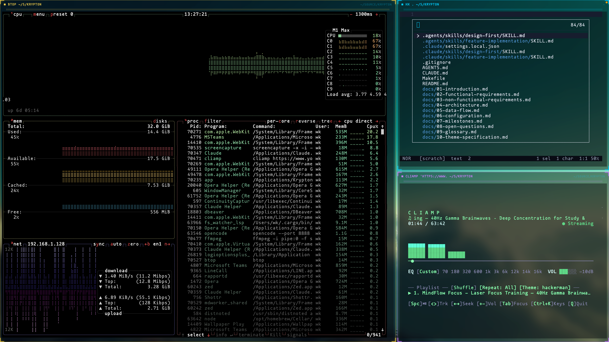

# Krypton

Keyboard-driven terminal emulator. Rust + Tauri v2, TypeScript + xterm.js.

One transparent native window. Terminals are DOM windows with custom chrome. Tiling workspaces, vim-style modes, and an ACP harness for running several coding agents side by side.



```sh
npm install
make dev       # run
make build     # bundle
make install   # macOS: /Applications + kryptonctl
```

Config: `~/.config/krypton/krypton.toml`. Specs: [`docs/`](docs/).

## GitHub Releases

The [release workflow](.github/workflows/release.yml) runs when an annotated
`vX.Y.Z` tag is pushed. It checks the version files and tests, builds signed and
notarized macOS DMGs for Apple Silicon and Intel, builds four `krypton-remote`
binaries, and publishes one GitHub Release after all assets pass verification.
The DMG does not install `kryptonctl`, `krypton-bridge`, or the browser extension.

Before tagging, update `package.json`, `package-lock.json`,
`src-tauri/tauri.conf.json`, `src-tauri/Cargo.toml`, and
`src-tauri/remote-runtime/Cargo.toml` to the same `X.Y.Z`, then refresh
`src-tauri/Cargo.lock`. Merge the release commit to `master` and run:

```sh
python3.12 scripts/verify-release.py version --tag vX.Y.Z
git fetch origin master
git tag -a vX.Y.Z origin/master -m "Release vX.Y.Z"
git push origin vX.Y.Z
```

The repository must have GitHub Actions secrets `APPLE_CERTIFICATE` (base64
Developer ID Application `.p12`), `APPLE_CERTIFICATE_PASSWORD`,
`KEYCHAIN_PASSWORD`, `APPLE_ID`, `APPLE_PASSWORD` (Apple app-specific password),
and `APPLE_TEAM_ID`. Missing signing or notarization credentials fail the build;
the workflow does not publish an ad hoc build. Check the workflow run and the
Release's DMGs, remote binaries, and SHA-256 files before announcing the version.
See [spec 295](docs/0295-github-release-automation.md) for the release gates.
