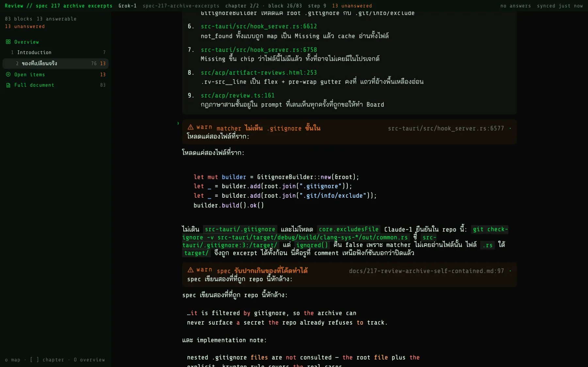
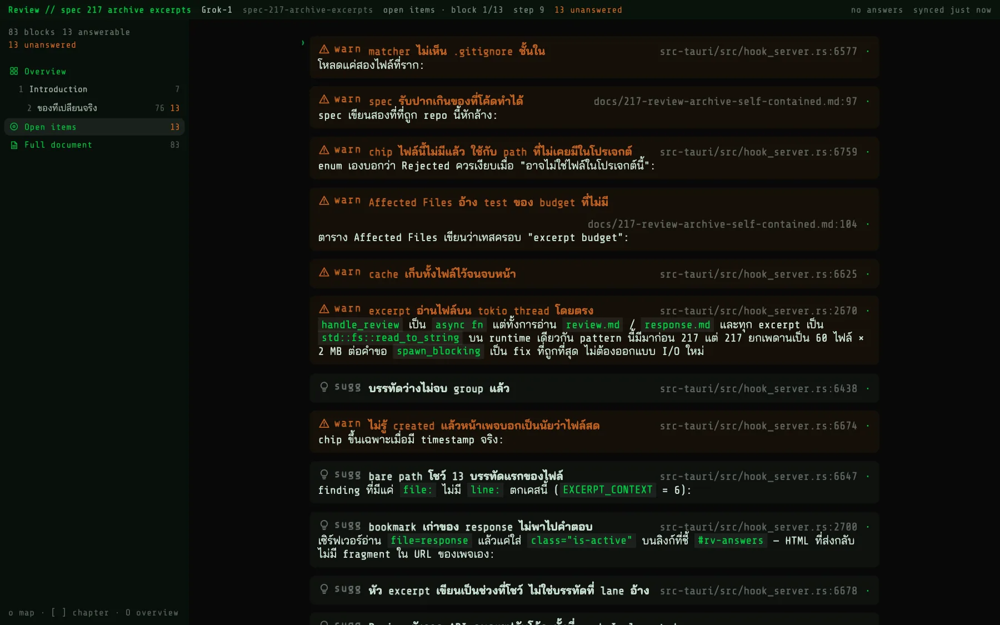
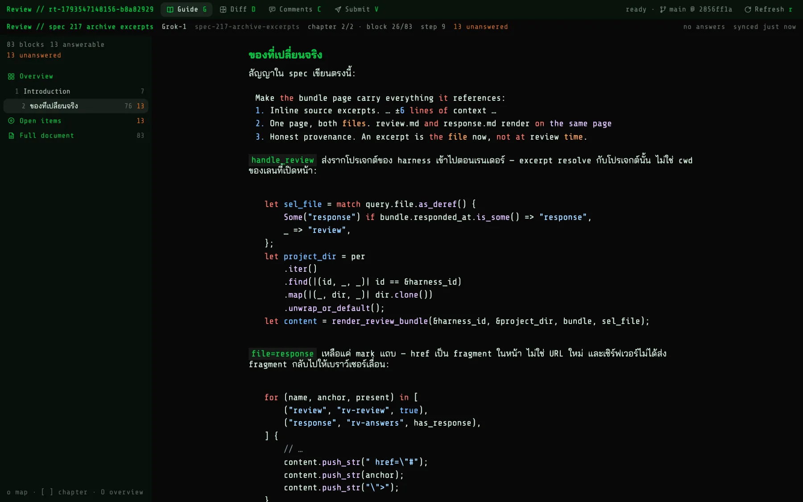
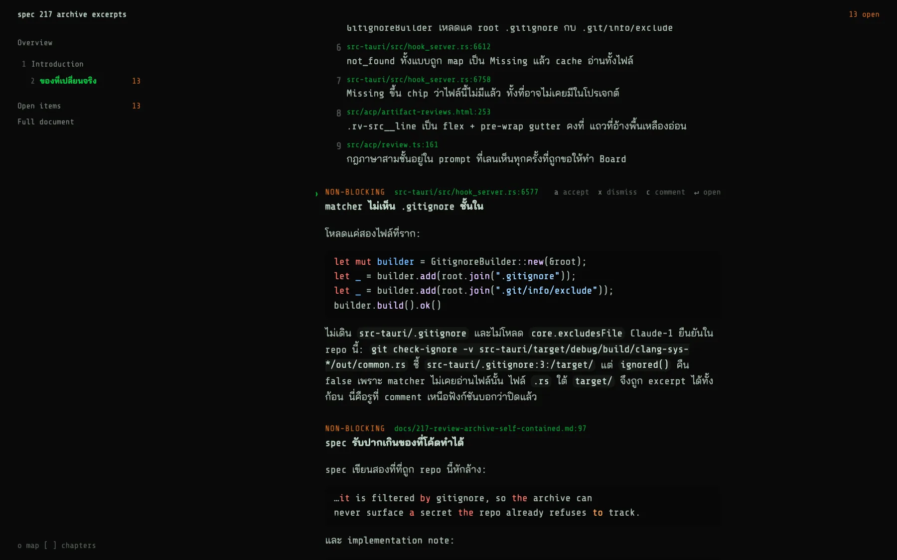
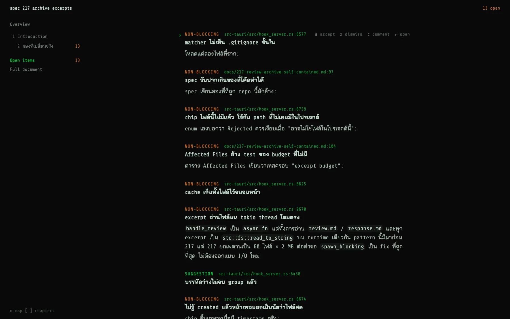
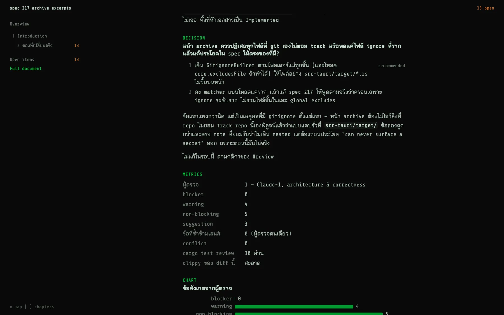
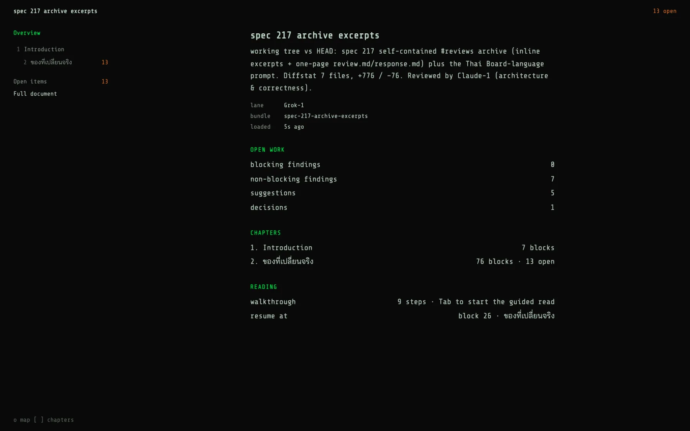
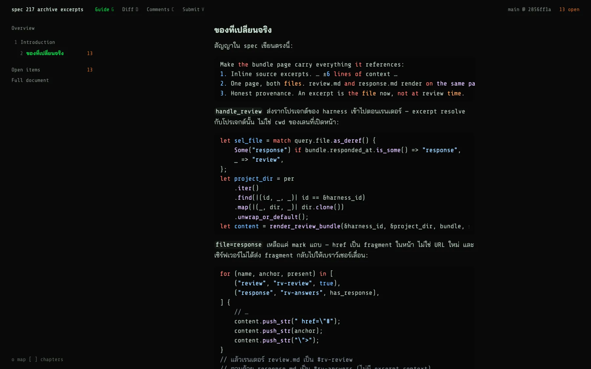
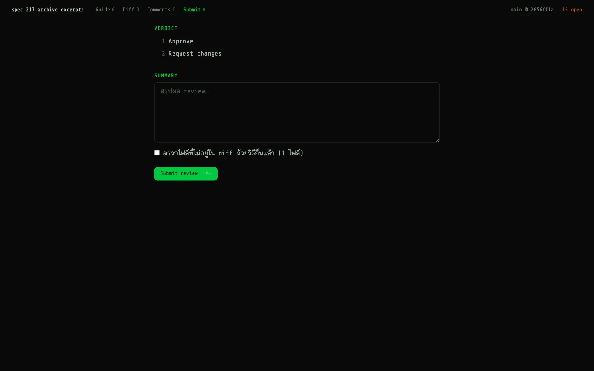

# Review Board Redesign — Typeset, Not Carded — Implementation Spec

> Status: Implemented
> Date: 2026-11-02
> Revised: 2026-11-02 — revision 1: leading icons on kickers and map rows; full-width reading column
> Milestone: visual chrome
> Related: [211](./0211-review-board.md), [244](./0244-review-board-chapters.md), [270](./0270-review-threads-without-worktrees.md), [350](./0350-minimal-workspace-footer.md), [ADR-0004](./adr/0004-review-matrix-observation-not-score.md), [ADR-0027](./adr/0027-no-left-edge-accent-rails.md)

## Problem

The user calls the Review Board "AI ugly". Two restyle rounds failed. Round one faded the region
dividers, and the user rejected it. Round two swapped every box border for a tinted fill, which left
the page as a stack of cards. The user's two constraints are now fixed:

- no divider lines between regions (header, Review Map, thread nav);
- no boxes around content.

The visual problems go beyond borders, as the screenshots of the current working tree show:





## Solution

Lay the Board out like a typeset document. Every structured block uses **one** pattern: a small
uppercase **kicker** line, a **title**, then the body. That is the Ticket dock's eyebrow + title, which
the user named as the house reference. Hierarchy comes from type size, weight, four ink tiers and
spacing, not from containers or fills. Icons are small monoline leading marks that take their
label's colour (revision 1), never badges or callouts. Colour labels structure and marks what is
actionable or still open; it never decorates titles or prose. Chrome reports exceptions only, the
same rule spec 350 applied to the workspace footer.

**Revision 1 (user request after shipping).** The user asked to widen the review content and add
SVG icons. The reading column now fills the body beside the map, and every typed-block kicker and the
`Overview` / `Open items` / `Full document` map rows lead with an icon. The Preview images below
predate this revision.

## Research

Diagnosis, from the screenshots above and from an audit of `src/styles/review-board.css` (working
tree):

- **Card soup.** Eight block kinds (walkthrough, finding, decision, chart, metrics, diff summary,
  blockquote, and thread comment/verdict) each get a rounded `--krypton-review-surface` fill.
  `block` and `warn` findings tint the whole card. A finding card wraps only its head and one line.
  The explanation the author wrote after it renders outside the card, so the card does not hold
  its own content.
- **Duplicate paragraph.** `takeFollowingProse()` (`parse.ts:708`) copies the paragraph that follows
  a finding into `detail`. The paragraph still renders as its own block, so every finding shows its
  first paragraph twice (visible in the chapter screenshot).
- **Icons and glyphs on everything.** Severity icons, map-row icons, and icons on every thread tab,
  heading, comment and verdict. `✎ n`, `· ✓ ✗` and `⚠` glyphs. Severity is abbreviated to
  `block` / `warn` / `sugg`.
- **Accent everywhere.** 69 uses of `--krypton-accent-rgb`, 27 of them on text: headings, paths,
  walkthrough anchors, map labels, inline-code chips. Warning orange colours whole finding titles and
  every open count.
- **Chrome that reports everything.** The header has 8 segments: `Review // title`, lane, slug,
  `chapter 2/2 · block 26/83`, `step 9`, `13 unanswered`, save state, sync age. The thread view
  stacks a second header with the same pattern on top. The Review Map opens with
  `83 blocks 13 answerable 13 unanswered` and shows two counts per row.
- **No scale.** 9 font sizes, 17 different padding amounts (the house scale has 6), and about 32
  alpha values (the house ladder has 5). Eleven declarations are bold.
- **Cramped Thai prose.** Prose uses the terminal line height (1.2). Thai stacks vowels and tone marks
  above and below the base line (W3C thai-lreq), and body text wants 120–145% line spacing (Butterick).
- **Comment overlay** quotes the raw fence (`` ```review:finding severity: non-blocking ``) when
  nothing is selected, because `blockHead()` (`view.ts:1416`) takes `block.raw`.
- **House reference** (Ticket dock, `ticket-dock.css`, `harness-shared.css`): transparent panes; one
  14px gutter; three type sizes; an uppercase chrome-size eyebrow; a title at 1em weight 650; values in
  ink-2 and labels in ink-3; counts as plain ink-3 text; icons only inside action buttons.
- Cell grid (spec 326) covers fenced code and `diff-raw` only. Prose line height is free to change.

## Prior Art

| App | Implementation | Contribution |
|---|---|---|
| CodeRabbit | Each finding is a callout with a severity badge and icon, and sections collapse | The "AI review bot" look this spec removes: badges, callout fills. Revision 1 icons are bare leading marks in the label's colour, not badges |
| Gerrit | Unresolved comments are plain rows with `file:line`; the reply summary is a separate surface | `file:line` as dim metadata; Open items stays a filtered list |
| Linear issue view (existing knowledge) | Document typography; properties are label/value rows with no boxes; status is a word | Kicker/title/body; metrics as label/value rows |
| Krypton Ticket dock / spec 350 footer | Eyebrow + title, ink tiers, exceptions-only status | The house pattern this spec adopts |

**Krypton delta.** No avatars, badges, or collapsible callouts. Every affordance stays a key. Key hints
appear only on the block under the cursor.

## Affected Files

| File | Change |
|------|--------|
| `src/styles/review-board.css` | Rewritten against the token set below. Drops card fills, severity tints, tinted bands and tab pills. Revision 1: one monoline `.krypton-review__icon` rule; the reading column loses its 80ch cap |
| `src/review-board/render.ts` | Shared kicker/title head for typed blocks. State words replace glyphs. Severity labels spelled out. `detail` renders only in Open items. Revision 1: `KickerSpec.icon` puts a leading icon in the kicker label |
| `src/review-board/view.ts` | Header, Map and Overview rebuilt as below. `statusHost` option, public `blockLabel()`. Comment quote fallback. In-place walkthrough step paint. Revision 1: the three non-chapter map rows lead with an icon |
| `src/review-board/thread-view.ts` | One header row, text tabs, restyled Comments and Submit. No icons |
| `src/review-board/icons.ts` | Deleted in the first pass; recreated in revision 1 as the Board's own icon set (`reviewIcon(name)`): monoline SVG bodies in a `0 0 16 16` box, parsed once and cloned per use (the workspace footer's pattern) |
| `src/review-board/view.test.ts`, `render.test.ts` | Delete source-text and label-mapping tests. Add one DOM regression test (finding prose renders once) |
| `docs/0211-review-board.md`, `docs/0244-review-board-chapters.md`, `docs/0270-review-threads-without-worktrees.md`, `docs/README.md` | Amend the UI sections to point here; add the index row |

## Design

### Tokens (declared once on `.krypton-review, .krypton-review-thread`)

| Token | Dark fallback | Use |
|---|---|---|
| `--rb-ink-1` | `rgba(fg, 0.96)` | titles, headings, active row, inline code |
| `--rb-ink-2` | `var(--krypton-ink-2, rgba(fg, 0.82))` | prose, values, option text |
| `--rb-ink-3` | `var(--krypton-ink-3, rgba(fg, 0.5))` | metadata, paths, labels, counts |
| `--rb-ink-4` | `var(--krypton-ink-4, rgba(fg, 0.34))` | key hints, list numbers, dismissed |

- **Type.** Three sizes: `--krypton-chrome-font-size` (header, map, kickers, hints), `--krypton-font-size`
  (body, block titles), and 1.25em (H1/H2 chapter headings). Two weights: 400 and 600. Line height is
  1.6 for prose, 1.35 for titles, and 1.4 for chrome. Code keeps the cell grid. Family stays
  `--krypton-font-family`.
- **Kicker** = chrome size, 600, `letter-spacing: 0.08em`, `text-transform: uppercase` (DESIGN.md
  label style). This replaces spec 211's "never uppercase" rule. Only the label word is uppercased.
  Paths and counts on the kicker line keep their case.
- **Spacing.** Only 4 / 8 / 14 / 20 / 28px. The reading column fills the body beside the map with
  28px gutters (revision 1; it was `max-width: 80ch`). Charts and authored SVG figures keep
  `max-width: 80ch`, because they scale with their `viewBox` and their text would grow with the
  column.
- **Icons (revision 1).** `reviewIcon(name)` from `src/review-board/icons.ts` returns an
  `<svg class="krypton-review__icon" aria-hidden="true">`: 1em square, no fill, 1.4 stroke in
  `currentColor`, round caps and joins. An icon has no colour of its own: it wears its container's
  (severity tone, accent, active map row, the ink-4 label of a dismissed finding). Icons appear in
  exactly two places: the leading mark inside a typed block's kicker label, and the `Overview`,
  `Open items` and `Full document` map rows. Header, chapter rows, Overview sections, overlays and
  the thread chrome stay text only.
- **Colour carries structure, never decoration.** Text stays in the ink tiers; colour marks only
  these, and nothing else:
  - **Accent:** every kicker and section label (the Ticket dock eyebrow, which is amber there);
    jump targets, which `Enter` opens (finding location, walkthrough anchors, comment locations), at
    0.7; the active map row; the current walkthrough step; the chosen decision option; the active
    thread tab; links; the chart series at 0.75; plus the cursor `›`, focus rings, the map's
    keyboard-selection tint, the search match and the primary button.
  - **Semantic hue:** the kicker label of `blocking` (danger) and `non-blocking` (warning) findings;
    open-work counts in the header and map (warning); the state word `accepted` (success); banner,
    diagnostic and `save failed` text.
  - **Never coloured:** titles, headings, prose, inline code, fills, whole rows.
- **Edges** are limited to floating panels (comment, send, search HUD, picker: opaque fill, 1px
  `rgba(fg, 0.12)`, 8px radius), text inputs outside a panel (the Submit summary), the one primary
  button, table-row hairlines (0.08), and authored `hr`. Inputs inside a panel are borderless. The
  narrow-pane map overlay stays an opaque fill with no edge. There are no region dividers, no block
  borders, and no block fills except the code well and inline code.

### Preview

The shipped `ReviewBoardView` / `ReviewThreadView`, on the same bundle as the screenshots above.
Compare with the before shots.








### Header (standalone Board)

- **Left:** the document title (ink-1, 600). When the map is hidden (narrow pane), it is followed by
  ` · <chapter title>` in ink-3. While search is open it shows `search · full document` (ink-3).
- **Right, exceptions only:** `N open` (warning), `all answered` (success) or `reference` (ink-3); then
  the save state if there are answers: `unsent`, `saving…`, `sent` (ink-3), or `save failed` (danger).
- **Removed:** the `Review //` prefix, lane, slug, block position, step count, and sync age. Lane, slug
  and loaded-age move to Overview. Step position moves to the walkthrough kicker.
- The header is transparent, with padding `14px 28px` and no rule below it.

### Review Map

- Transparent, 240px wide, chrome size, with no head counts.
- Rows, top to bottom: `Overview`; the chapters; a 14px gap; `Open items`; `Full document`.
  - Chapter rows show the number (ink-4, tabular), the title (ink-3), and the open count when it is
    more than 0 (warning, tabular, right-aligned).
  - `Open items` shows its count.
  - There are no block counts. `Overview` (four tiles), `Open items` (inbox tray) and `Full document`
    (page) lead with an icon drawn in a 2ch box, the width of the chapter-number column, so every
    label starts at the same x. Chapter rows keep their number and get no icon.
- The **active** row is accent at weight 600. The **keyboard-selected** row gets a full-row accent
  tint at 0.12 with radius 8px and no border (Rails dock pattern).
- The footer hint `o map  [ ] chapters` (`j k move  ↵ open  Esc back` while the map holds the
  keyboard) stays on one line in ink-4, with no rule above it.

### Blocks

Every typed block is `kicker` → `title` → body. Typed blocks get a 28px top margin. The kicker is
4px above the title, and the body starts 8px below it. The kicker label leads with its kind's icon
(revision 1), inside the label so it takes the label's colour. The kicker's right side holds, in
order: the state word, `n comments` (ink-3), and — **only on the cursor block** — key hints in ink-4.

| Kind | Icon | Kicker | Title | Body |
|---|---|---|---|---|
| finding | stop octagon `!` (blocking) / warning triangle `!` (non-blocking) / light bulb (suggestion) | `BLOCKING` (danger) / `NON-BLOCKING` (warning) / `SUGGESTION` (accent), the authored severity, + location (accent 0.7); state `ACCEPTED` (success) or `DISMISSED` (ink-4, label ink-4 too); hints `a accept  x dismiss  c comment  ↵ open` | `data.title` (ink-1 600; ink-3 when dismissed) | `detail` only in Open items view |
| decision | one path splitting in two | `DECISION`; state `ANSWERED`; hints `1–9 choose  c comment` | question | options: number (ink-4, hanging 3ch), text (ink-2), `recommended` (ink-3, right); chosen = accent number and text at 600 |
| walkthrough | a route between two nodes | `WALKTHROUGH` + `9 steps`; `step 3 of 9` while guided; hint `Tab next step` | `data.title` or `Read it in this order` | steps: number (ink-4, hanging), anchor (chrome size, accent 0.7), explanation (ink-2); current step = full accent number and anchor; drifted = ink-4 `(no anchor)` |
| metrics | label / value rows (never a gauge, ADR-0004) | `METRICS` | — (the block has no title) | label (ink-3) / value (ink-2, tabular) grid, 28px column gap, 4px row gap |
| chart | horizontal bars off an axis | `CHART` | chart title | SVG bars accent 0.75, labels ink-3, values ink-2; at most 80ch wide |
| diff | `±` | `DIFF` + `n lines` | — | collapsed: `Enter to expand` (ink-4); expanded: diff2html without its file box |
| svg | — | — | — | figure, at most 80ch wide |

- **Markdown.**
  - `p` uses ink-2, line height 1.6, and `0.8em` bottom margin.
  - H1/H2 use ink-1, 600, 1.25em, and a 28px top margin, with no accent and no underline. H3+ use
    ink-1, 600, 1em.
  - Inline code uses ink-1 on `rgba(fg, 0.06)`, with `0.05em 0.4ch` padding and the house radius.
  - `pre` is a well: `rgba(0,0,0,0.32)` on dark, `rgba(fg,0.05)` on light, 8px radius, `8px 14px`
    padding, no border.
  - Blockquote is ink-3 with a 2ch inset, no fill, and no rail (ADR-0027).
  - List markers use ink-4. Table headers use ink-3 at chrome size.
- **Cursor.** The accent `›` stays in the gutter (spec 211).
- **Banner.** A line of warning-hue text, with no band.
- **Empty states.** Centred ink-3 text, with no mark.

### Overview

- The title is 1.25em ink-1, with the subject below it in ink-2.
- Next come meta rows with an ink-3 label column (`lane`, `bundle`, `loaded`) and ink-2 values.
- Then three kicker sections: `OPEN WORK`, `CHAPTERS` and `READING`. Their rows are label (ink-2) and
  value (ink-2, tabular, right-aligned).
- Counts only, never a score (ADR-0004).

### Overlays

The comment, send preview, search HUD and review picker are all one panel. None has a tinted head
band or an internal rule.

- **Comment.** Head `Comment on` (ink-3), the block label below it (ink-1, 600), and the selected
  text (ink-3) only when there is a selection. A borderless textarea, because the panel is the
  edge. Foot `⌘↵ save  Esc cancel` (ink-4).
- **Send.** Head `Send to <lane>`. Rows show the mark word (ink-3, 12ch column) and the label
  (ink-2). Then the note textarea, then the foot `⌘↵ send  Esc cancel`.
- **Picker.** Date (ink-4, tabular), project (ink-3), title (ink-2). The selected row gets a 0.12
  accent tint.

### Thread view

- **One header row.**
  - Left: the Board's document title (fallback `Review thread`).
  - Then the tabs `Guide G  Diff D  Comments C  Submit V` as text. The active tab is accent at 600,
    the others ink-3, and key letters ink-4.
  - Right: the phase only when it is not `ready`; stale and obsolete notices (warning); then
    `main @ 2856ff1a` (ink-3); then the Board's open count and save state.
- The embedded Board renders no header. The thread passes a persistent `statusHost` element
  (`ReviewBoardOptions.statusHost`); the Board writes its status segments (open count, save state,
  search, flash) into it, and the thread re-appends that same node every time it rebuilds the nav.
  Guide comments are labelled with the Board's public `blockLabel(id)`.
- Deviation recorded during implementation: a callback was considered, but a host node keeps the
  Board's flash messages and status in one owner without a second status model.
- The `Refresh` button is removed. `r` still refreshes. `Retry Guide` appears only on `guide_failed`.
- **Comments** sits in the same full-width column with the kickers `LINE COMMENTS 2`, `GUIDE COMMENTS n` and
  `VERDICTS n`.
  - Each row is the location (ink-3) above the body (ink-2).
  - Verdict rows: `Request changes` in warning or `Approve` in success, then the delivery word (ink-3),
    then the summary (ink-2).
- **Submit** sits in the same column.
  - Kicker `VERDICT`, then `1 Approve` and `2 Request changes` as decision-style option rows.
  - Kicker `SUMMARY` with the textarea.
  - The omitted-files checkbox row.
  - One primary `Submit review ⌘↵` button (DESIGN.md primary).
- **Guide pending or failed:** a centred ink-3 message plus the existing `เปิด snapshot diff D`
  button, with no icon.

### Behaviour changes

1. A finding's `detail` renders only in Open items. In chapter and full-document views the author's
   following paragraph is already on screen. This fixes the duplicate.
2. With no selection, the comment quote is the block label (`blockLabel()`, the label send already
   uses) instead of the first two raw lines.
3. Header, map and thread chrome drop the fields listed above. Every removed field is still available
   in Overview or the walkthrough kicker, except sync age: `r` and lane-idle refresh are unchanged,
   and `loaded` moves to Overview.

### Keybindings

Unchanged (spec 211 / 244 / 270).

### Configuration

None.

## Edge Cases

- **Long location and many hints on one kicker:** the kicker wraps, with the right group pushed to a
  second line. A title never shares a line with the kicker.
- **Light scheme:** ink tiers resolve to spec 321's opaque `--krypton-ink-*`. The code well switches to
  the light value. No hex values.
- **Narrow pane (< 1180px):** the map overlay is an opaque fill with no edge (unchanged). The header
  gains the chapter title.
- **Board with nothing answerable:** the header shows `reference`. No state or hints appear.
- **Dismissed finding:** it stays in place, dimmed (title ink-3, label and its icon ink-4). It is never
  hidden.
- **Wide pane:** prose, code wells and diffs span the full body. Charts and SVG figures stop at 80ch,
  so their `viewBox` text keeps its size.
- **Thai titles:** uppercase has no effect on Thai, so kickers stay English labels. Only the label
  word is uppercased.
- **Approve unavailable** (stale snapshot or Guide not ready): the `1 Approve` row is ink-4 and its
  reason shows beside it in ink-3, not only in a hover title.
- **Reduced motion:** no animation is added.

## Open Questions

None.

## Out of Scope

- The Diff Window (`diff-view.ts`) and its comment UI.
- The `/reviews` browser archive (DESIGN.binance.md).
- The `review.md` format, parse rules, response format, keys, and send payload. The comment-quote
  fallback is the one stored-text change.
- Grouping prose under its finding, collapsing sections, and new views.
- The comment-drop bug found while previewing: `startComment()` set `commentBlockId`, then
  `openOverlay()` called `closeOverlay()`, which cleared it, so `commitComment()` discarded every
  Board comment (present since `23ed978`). Fixed separately: `openOverlay()` now only tears down the
  old overlay node (`removeOverlay()`); `closeOverlay()` alone clears the comment target. Covered by
  `src/review-board/view.dom.test.ts`.

## Resources

- [Butterick — Line spacing](https://practicaltypography.com/line-spacing.html) — 120–145% body line spacing; basis for 1.6 on mixed Thai/Latin mono prose.
- [Butterick — Summary of key rules](https://practicaltypography.com/summary-of-key-rules.html) — line length 45–90 characters; basis for the first pass's 80ch column, which revision 1 widened to the full body at the user's request (charts and figures keep 80ch).
- [W3C Thai Layout Requirements](https://www.w3.org/TR/thai-lreq) — stacked vowels and tone marks; why Thai needs taller lines than 1.2.
- [CodeRabbit — Understand findings](https://docs.coderabbit.ai/change-stack/findings) — the badge/callout finding pattern this design avoids.
- [Gerrit Review UI](https://gerrit-review.googlesource.com/Documentation/user-review-ui.html) — unresolved comments as plain `file:line` rows.
- `DESIGN.md` (label style, spacing scale, focus, form controls), ADR-0027 (no left rails), ADR-0004 (no score), `src/acp/components/ticket-dock/ticket-dock.css` and `src/styles/harness-shared.css` (house eyebrow/title, ink tiers).
