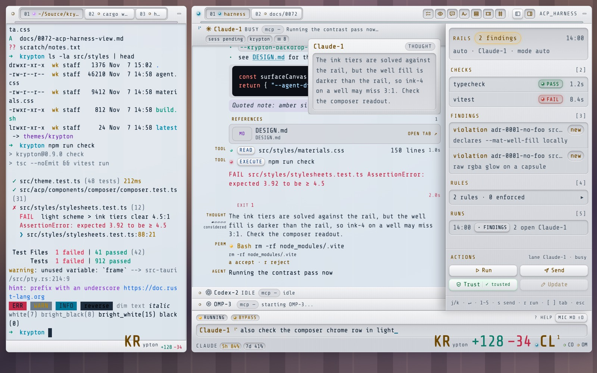

# Light Scheme Redesign — Implementation Spec

> Status: Draft
> Date: 2026-11-07
> Milestone: Themes — light scheme
> Amends: [0366](./0366-console-faceplate-ui.md) (the light material set) · [0321](./0321-light-scheme-legibility.md) (light surfaces) · DESIGN.md 2.0.0 (light statements)

## Problem

The light scheme is the graphite faceplate re-tinted, not designed for a light ground. A fixture with the
real stylesheets, real harness components and `themeCssProperties(krypton-light)` at `[visual] opacity`
0.7 shows it (`docs/images/0367-light-before-*.jpg`):

1. **Four temperatures on one window.** Frost-blue screen `#e6eff6` (OKLCH hue 241), neutral aluminium
   plate (hue 265–271), brown silk labels `#6e4700` (hue 73), cyan accent `#006688` (hue 230). The amber
   selection tint lands on grey as beige (file list, palette, markdown sidebar).
2. **Wells are grey slabs.** Light wells are a darker translucent grey (`194–222` at 0.68–0.72). Lists,
   readouts, the path and status bars, the palette list and the draft line read as dirty slots; over a
   dark wallpaper a well composites to `(140, 142, 146)`.
3. **Heavy metal shading.** The plate runs OKLCH L 0.94 → 0.85 under a 45% white sheen. Each strip
   reads as a separate bar of brushed metal.
4. **Brown everywhere.** Every engraved label (tabs, `TOOL` / `THOUGHT` / `PERM` / `AGENT`, section
   heads, lane names, backlit titles) is `#6e4700`: amber that had to darken to brown to reach 4.5:1.
5. **Dark-tuned syntax colours.** Sealed assistant fences, Quick Overview and the Diff Window take token
   colours from `highlight.js/styles/github-dark*.css`. On a light well they measure 1.4–2.8:1 (`#a5d6ff`
   1.42, `#79c0ff` 1.80, `#ff7b72` 2.33, `#8b949e` 2.84).

## Solution

Give the light scheme its own material instead of a re-tint: **a matte light panel with white windows.**
The plate is a near-flat cool light grey with no brush and no sheen. Wells and the screen are white
windows set into it: lighter than the plate, the recess drawn by a 1px wall and a soft top shadow, as
macOS and Zed draw fields on grey chrome. Labels are graphite. Amber is kept for what is lit (a backlit
legend, LEDs, selection), so it is the one warm colour on the panel. One cool-neutral temperature
(hue 255–271, chroma ≤ 0.01) covers plate, wells and screen; the cyan accent fits it. Syntax colours map
to the theme's own ANSI palette under the light scheme. Dark does not change.

## Research

- **Where light comes from.** `materials.css` declares the light set once (`krypton.scheme`,
  `html[data-theme-scheme='light']`); every surface reads `--mat-*`, so the material change is one block.
  The screen is `--mat-screen` = the theme backdrop (`krypton-light.toml` `[chrome.backdrop]`). Ink tiers
  `--krypton-ink-2/3/4` are solved per theme against the rail (`theme.ts` `lightInkTiers`), so they
  follow a new backdrop without code changes.
- **Hard-coded literals are no longer the issue.** A scan of 114 sheets finds 13 dark literal
  backgrounds and 21 light literal text colours in base rules, mostly overlay pickers; the 65 light
  rules sit in 23 files. The look is decided by the material tokens.
- **Contrast of the proposed tokens** (WCAG, plate/well/key composited over black and over white,
  worst case): graphite silk `#3f4752` 7.1:1, lit `#9a4d00` 4.62:1 (on a latched key), theme fg
  `#1c2c3c` 10.8:1, accent `#006688` 4.87:1, ink-3 `#556370` 4.66:1.
- **Syntax tokens.** Normal krypton-light ANSI on a light well: red 5.12, green 4.67, blue 5.41,
  magenta 6.29, cyan 4.74, white 5.14; yellow 4.34 and the bright set 3.0–3.9 are not used for text.
- **Rejected.** (1) Warm paper (Rosé Pine Dawn, Braun): every ANSI colour and the cyan accent would
  need retuning, and warm wells under amber LEDs lose the lamp. (2) Keeping grey wells and only
  re-colouring labels: fixes item 4, not 1–3. (3) A per-theme `[tokens]` patch in `krypton-light.toml`:
  custom light themes would keep the old look.

## Prior Art

| App | Light treatment | Notes |
|---|---|---|
| Zed One Light | Chrome `#dcdcdd`, panels `#ebebec`, editor `#fafafa`; text `#242529`, muted `#58585a` | Content is the lightest surface; chrome is darker grey |
| Catppuccin Latte | crust `#dce0e8` < mantle `#e6e9ef` < base `#eff1f5`; text `#4c4f69` | One cool hue across all surfaces |
| Rosé Pine Dawn | base `#faf4ed`, surface `#fffaf3`, overlay `#f2e9e1`; text `#464261` | One warm hue; surfaces lift by lightness |
| macOS (Aqua light) | Grey window chrome, white text fields with an inset border | A recess is a white field, not a darker slot |
| Teenage Engineering / Braun | Light body, dark printed legends, one accent colour | Light hardware prints legends dark |

**Krypton delta.** Same structure as these: one temperature, content lighter than chrome, dark legends.
Krypton keeps its parts (plate, well, key, lamp) and spends amber only on what is lit.

## Affected Files

| File | Change |
|---|---|
| `src/styles/materials.css` | Replace the `krypton.scheme` light block with the set below |
| `src-tauri/themes/krypton-light.toml` | Backdrop / background `rgba(252, 252, 253, 0.97)`; neutral `[chrome.border]`; `version` 1.3.0; description |
| `src/styles/theme-scheme.css` | Declare `--krypton-warn-ink` on the light root; light-only `.hljs*` rules: transparent block, tokens on `--krypton-ansi-*` and ink tiers |
| `src/styles/*.css`, `src/acp/components/*/*.css` light rules | The six `#8a5a00` warning inks become one light `--krypton-warn-ink: #825500` (4.88:1 worst case on every light surface; `#8a5a00` is 4.48 on a latched key); the `#6e4700` literals become `var(--mat-silk)` or `var(--mat-lit)` by role |
| `src/theme.test.ts`, `src-tauri/src/theme.rs` test | Re-point the `230, 239, 246` krypton-light backdrop pins |
| `DESIGN.md` | Light material, labels and screen; Transparency (plates 0.97); Accessibility contrast; changelog 2.1.0 |
| `docs/0010-theme-specification.md`, `docs/0321-…`, `docs/0366-…`, `docs/README.md` | Light-scheme rules and index row |

## Design

### Light material set (`materials.css`, `krypton.scheme`)

| Token | Now | New |
|---|---|---|
| `--mat-plate-sheen` | `rgba(255,255,255,.45)` | `rgba(255,255,255,0)` |
| `--mat-plate-hi / mid / lo` | `234,235,238` / `218,220,224` / `204,207,212` @ .94 | `240,241,244` / `234,236,240` / `228,231,235` @ .97 |
| `--mat-brush-hi / lo` | `.035` / `.0045` | `0` / `0` (matte) |
| `--mat-bevel-hi / lo` | white .85 / black .2 | white .9 / `rgba(16,24,40,.14)` |
| `--mat-well-hi / lo` | `194,197,203` .72 / `222,224,228` .68 | `244,245,247` / `249,250,251` @ .96 |
| `--mat-well-fill` | `208,211,216` .7 | `246,247,249` .96 |
| `--mat-well-depth / wall / lip` | `inset 0 2px 4px rgba(0,0,0,.16)` / black .14 / white .85 | `inset 0 1px 2px rgba(16,24,40,.10)` / `rgba(16,24,40,.12)` / white .9 |
| `--mat-groove-lo / hi` | black .12 / white .6 | `rgba(16,24,40,.09)` / white .8 |
| `--mat-key-*` | white → `223,225,229` | white → `245,246,248` @ .98; hover a step lighter; down `226,229,234` → `234,236,240` |
| `--mat-key-edge` | black .22 | `rgba(16,24,40,.2)` |
| `--mat-key-raise / sunk` | 4-layer stack | `inset 0 1px 0 #fff, 0 1px 0 rgba(16,24,40,.05), 0 1px 3px rgba(16,24,40,.10)` / `inset 0 1px 2px rgba(16,24,40,.14), inset 0 0 0 1px rgba(16,24,40,.05)` |
| `--mat-silk` | `#6e4700` | `#3f4752` (graphite) |
| `--mat-lit` / `--mat-lit-glow` | `#6e4700` / white engraving | `#9a4d00` / none |
| `--mat-engrave` / `--mat-print` | white .85 / .9 | white .6 / .7 |
| `--mat-lens-off-mid / lo` | `176,160,130` / `120,104,76` | `200,194,182` / `156,148,134` |
| `--mat-select` | amber .2 | `rgba(255,170,0,.18)` (pale amber on white) |
| `--mat-scrim` / `--mat-cast` | `40,42,48` .28 / `0 8px 22px` black .18 | `rgba(28,32,40,.22)` / `0 12px 32px rgba(16,24,40,.16), 0 1px 3px rgba(16,24,40,.08)` |

Luminance order: plate (L 0.93–0.96) < wells (0.97) < screen (0.99). A well on the plate is a white
window; a well on the screen (fence, tool output) is a faint grey field, as on GitHub.

### Theme (`krypton-light.toml`)

`[colors] background` and `[chrome.backdrop] color` become `rgba(252, 252, 253, 0.97)`;
`[chrome.border] color` becomes `rgba(16, 24, 40, 0.18)`. Foreground, cursor, selection and ANSI stay.

### Syntax colours (light only, `theme-scheme.css`)

`html[data-theme-scheme='light'] .hljs` gets a transparent background and `color: inherit`. Tokens:
keyword, selector-tag → `--krypton-ansi-5`; string, addition → `-2`; number, literal, tag, deletion →
`-1`; title, function, name, attr → `-4`; type, class, built_in, symbol → `-6`; comment, punctuation,
operator → `--krypton-ink-3`; variable, params → inherit. The selectors outrank the github-dark sheet
by specificity, so import order does not matter, and dark keeps github-dark.

### Data flow

Unchanged: `theme-changed` → `themeCssProperties` → `data-theme-scheme` → the light block of
`materials.css` re-resolves every `--mat-*` reader.

## Edge Cases

- **Dark scheme.** Every change sits under `data-theme-scheme='light'` or in `krypton-light.toml`, so
  krypton-dark and legacy-radiance render as before; the verification step diffs them.
- **Custom light themes.** They get the new material automatically; `[tokens]` can still recolour any
  stop. A theme whose backdrop is not white keeps its own screen colour, and the white wells still read.
- **User copy of `krypton-light.toml`** in `~/.config/krypton/themes/` shadows the bundle and keeps the
  frost backdrop until removed; the material change applies either way.
- **Lane and window accents as text** keep the spec-321 OKLCH cap; nothing changes there.
- **Sealed rows.** Stylesheet and root-variable change only; no row DOM is written.

## Open Questions

None.

## Out of Scope

The dark scheme, the ANSI palette, layout or geometry, loopback pages (`DESIGN.binance.md`), the
Raycast extension, and the 34 hard-coded literals listed in Research (a follow-up if any shows up as
an island once the material changes).

## Verification

- The fixture from Problem, rebuilt from the working tree: light and dark, over a dark wallpaper and over
  white, full window plus close-ups; screenshots before and after in the PR.
- A contrast script over computed colours: every text tier ≥ 4.5:1 (labels ≥ 7:1) on every light surface.
- Dark: the same fixture on both builds gives identical computed colours.
- `npm run check`, `npx vitest run`, `cargo test`; `npx @google/design.md lint DESIGN.md`.

## Resources

- [Catppuccin palette](https://catppuccin.com/palette) — Latte surface and text steps.
- [Rosé Pine palette JSON](https://raw.githubusercontent.com/rose-pine/palette/main/palette.json) — Dawn surfaces and text.
- Zed `assets/themes/one/one.json` (local `/Users/wk/Source/zed`) — One Light surface ladder and text tiers.
- [highlight.js github-dark](https://github.com/highlightjs/highlight.js/blob/main/src/styles/github-dark.css) — the token colours measured above.
- [WCAG 2.2 SC 1.4.3](https://www.w3.org/WAI/WCAG22/Understanding/contrast-minimum.html) — 4.5:1 / 3:1 thresholds.
